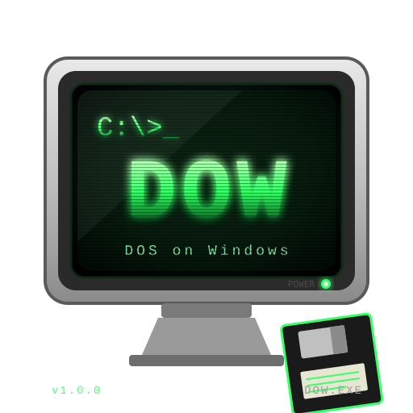

<h1>DOS on Windows</h1>

## Features

- DOS-style prompt (`C:\>`)
- Drive letters (`C:`, `A:`, ...) mapped to real folders
- Common DOS commands (see below)
- Configurable prompt via `PROMPT` (`$P`, `$G`, `$T`, `$D`, ...)
- Case-insensitive commands and aliases
- No third-party runtime dependencies
- Builds to a single `DOW.exe` with PyInstaller

## Run from source

```cmd
python main.py
Requires Python 3.10+.

Build the .exe
cmd
pip install pyinstaller

pyinstaller --onefile --console --name DOW ^
  --hidden-import=dow --hidden-import=commands --hidden-import=library ^
  --hidden-import=terminal --hidden-import=disk --hidden-import=window ^
  --hidden-import=dos_sys main.py
Output: dist\DOW.exe

Optional icon:

cmd
pyinstaller --onefile --console --name DOW --icon=dow.ico main.py
Commands
Command	Aliases	Description
DIR [path] [/W]	—	List files and directories
CD [path]	CHDIR	Show or change directory
MD <path>	MKDIR	Create a directory
RD <path>	RMDIR	Remove an empty directory
DEL <file>	ERASE	Delete a file
REN <old> <new>	RENAME	Rename a file
TYPE <file>	—	Print a text file
COPY <src> <dst>	—	Copy a file
MOVE <src> <dst>	—	Move a file
TREE [path]	—	Print directory tree
CLS	—	Clear the screen
ECHO [text]	—	Print text
SET [name=value]	—	Show or set environment variables
PROMPT [text]	—	Change the prompt
PATH [path]	—	Show or set search path
DATE	—	Show the date
TIME	—	Show the time
PAUSE	—	Wait for Enter
VER	—	Show DOW version
HELP [cmd]	?	List commands or show help
EXIT	QUIT	Quit DOW
Switch drives by typing A:, C:, etc.

Project structure
text
main.py        entry point
dow.py         shell loop, prompt, environment
commands.py    command dispatch and implementations
library.py     command metadata
disk.py        drive mapping and path handling
terminal.py    input/output helpers
window.py      banner and formatting
dos_sys.py     platform helpers
DOW-logo.svg   logo
Note: sys.py is named dos_sys.py to avoid clashing with Python's standard sys module. This is required for a working PyInstaller build.

Example
text
C:\> MD PLAY
C:\> CD PLAY
C:\PLAY> ECHO hello > note.txt
hello > note.txt
C:\PLAY> DIR

 Directory of C:\PLAY

  .          <DIR>
  ..         <DIR>
  note.txt            20
      1 file(s)              20 bytes
      0 dir(s)

C:\PLAY> TYPE note.txt
hello > note.txt
C:\PLAY> CD ..
C:\> EXIT

DOW terminated.
Notes
DOW emulates the DOS shell, not 16-bit DOS binaries.

All file operations use the host filesystem via Python's os and shutil.

The .exe must be built with --console (it needs a terminal window).
